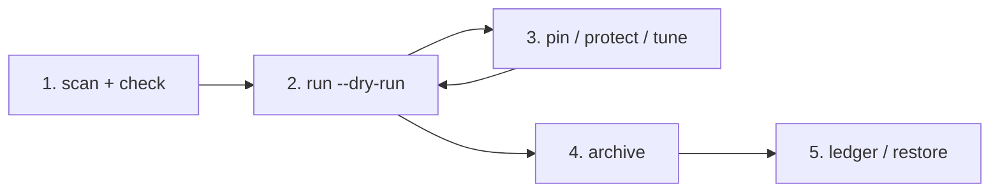

# omp-curator

Usage-driven skill lifecycle for [Oh My Pi](https://github.com/can1357/oh-my-pi) (OMP), modelled on the [Hermes Agent curator](https://hermes-agent.nousresearch.com/docs/user-guide/features/curator) and compatible with [vercel-labs/skills](https://github.com/vercel-labs/skills).

- **Measures real usage** from the session history of five harnesses: OMP, Claude Code, OpenCode, Codex and DeepSeek Harness (DSH). `init` backfills everything already on disk, so rankings start from your past sessions, not from zero. Shell commands that only touch a skill directory count as *mentions*, never as use.
- **Lifecycle** `active → stale → archived`, with pins, protect globs, and agents' `autoloadSkills` protected automatically. Archiving is a move. Nothing is deleted unless you `purge`.
- **Lazy loading.** Only active skills are listed in the system prompt. Archived skills become *dormant*: they cost no prompt tokens but still load on demand through `skill://`, `/skill:`, prompt hints and the `skill_search` tool. A dormant skill that gets used again is promoted back to active.
- **One store.** `~/.omp/agent/skills` holds the only copy of every skill, and `~/.agents/skills` (the `skills` CLI canonical root) is a symlink to it. `skills add -g` installs straight into OMP, and `skills ls -g` lists every OMP skill.
- **OMP extension.** It runs a background pass once per interval, serves dormant skills, and exposes `/curator`.

## Install

### For humans

Requirements: [Bun](https://bun.sh) ≥ 1.3, git, and OMP. The [`skills`](https://www.npmjs.com/package/skills) CLI is optional; only `update` and `track` use it.

1. **Clone the repository.**

   ```sh
   git clone git@github.com:nmindz/omp-curator.git ~/Projects/omp-curator
   ```

2. **Put the CLI on your `PATH`** and check that it runs.

   ```sh
   mkdir -p ~/.local/bin
   ln -s ~/Projects/omp-curator/bin/omp-curator ~/.local/bin/omp-curator
   omp-curator help
   ```

3. **Back up your skills** (recommended). `init` moves and deduplicates skill folders. Drop `.agents` from the command if `~/.agents` does not exist.

   ```sh
   mkdir -p ~/Backups
   tar -czf ~/Backups/skills-before-omp-curator-$(date +%Y%m%d).tar.gz -C ~ .omp/agent/skills .agents
   ```

4. **Preview the setup.** Nothing is written.

   ```sh
   omp-curator init --dry-run
   ```

   Read the `link:` lines (what moves into the store, which duplicates are dropped, which conflicts are parked) and the `would …` lines (how each skill will be labelled).

5. **Decide on automatic archiving.** By default, the weekly pass archives skills idle for 90 days. To archive only when you run it yourself:

   ```sh
   omp-curator config autoArchive false
   ```

6. **Initialize.** This links `~/.agents/skills` to the OMP store, backfills usage from every harness's history and labels each skill. It never archives anything.

   ```sh
   omp-curator init
   ```

7. **Register the OMP extension** in `~/.omp/agent/config.yml`. It also ships the `omp-curator` skill.

   ```yaml
   extensions:
     - ~/Projects/omp-curator
   ```

8. **Restart OMP** (or `/reload`), then check:

   ```sh
   omp-curator status    # link → OMP store, counts per state, next automatic pass
   omp-curator doctor    # stray links, lock drift, SKILL.md files OMP cannot load
   ```

   Inside OMP, `/curator status` answers the same way and the `skill_search` tool is available to agents.

`init` makes `~/.agents/skills` a symlink to the OMP store. Existing entries move into the store. A store entry that was only a link into `~/.agents/skills` is replaced by the real directory, and an independent identical copy is dropped. An entry that differs from a same-named store skill is parked under `~/.omp/agent/curator/conflicts/`. `init` refuses to run when the store and `~/.agents/skills` resolve into each other. It then backfills usage from every session history and records each skill. The first pass labels skills but never archives anything. Automatic passes start one interval later.

To uninstall: `omp-curator restore` every archived skill (`omp-curator list --state archived`), run `omp-curator unlink`, remove the `extensions:` entry and the `~/.local/bin/omp-curator` link, then delete `~/.omp/agent/curator`.

### For AI agents

Give this block to an agent (OMP, Claude Code, Codex, …) to install omp-curator for its user.

````markdown
# Task: install omp-curator for OMP

omp-curator tracks skill usage across agent harnesses and archives unused OMP skills.
Repository: git@github.com:nmindz/omp-curator.git (private; the user's `gh` or SSH login has access).

## Rules
- Do not run `omp-curator run`, `prune`, `archive` or `purge`. Installing never requires them.
- Do not install packages with npm/npx. Bun is the only runtime needed.
- Stop and ask the user at every step marked ASK. Do not decide for them.
- Report each command's actual output; do not summarize from memory.

## Steps
1. Check prerequisites: `bun --version` (must be ≥ 1.3), `git --version`, and that
   `~/.omp/agent/` exists. If one is missing, stop and tell the user.
2. Clone: `git clone git@github.com:nmindz/omp-curator.git ~/Projects/omp-curator`
   (if it already exists, `git -C ~/Projects/omp-curator pull --ff-only` instead).
3. Link the CLI:
   `mkdir -p ~/.local/bin && ln -sfn ~/Projects/omp-curator/bin/omp-curator ~/.local/bin/omp-curator`.
   Confirm `command -v omp-curator` resolves. If `~/.local/bin` is not on PATH, tell the user;
   do not edit their shell rc files.
4. Back up: `mkdir -p ~/Backups && tar -czf ~/Backups/skills-before-omp-curator-$(date +%Y%m%d).tar.gz -C ~ .omp/agent/skills .agents`
   (omit `.agents` if it does not exist). Report the archive path and size.
5. Preview: `omp-curator init --dry-run`. Show the user the `link:` lines and the count of
   `would` lines. ASK: proceed with init?
6. ASK: should the weekly automatic pass archive idle skills (default), or only label them?
   If "only label": `omp-curator config autoArchive false`.
7. Initialize: `omp-curator init`.
8. Register the extension: add `~/Projects/omp-curator` under `extensions:` in
   `~/.omp/agent/config.yml`, keeping existing entries. Do not duplicate it if present.
9. Verify: `omp-curator status` (expect `link: … → OMP store`) and `omp-curator doctor`.
   Report warnings verbatim; do not fix them without asking.
10. Tell the user to restart OMP (or run `/reload`) so the extension and the
    `omp-curator` skill load, and that `omp-curator run --dry-run` previews archiving.
````

## Routine: check, preview, archive

Run the read-only steps whenever you like. Only step 4 moves skills.



1. **Refresh and check** (read-only except for the usage cache).

   ```sh
   omp-curator scan                    # pull new usage from every harness
   omp-curator status                  # counts per state, last and next automatic pass
   omp-curator list --state due        # what the next pass would archive
   omp-curator list --sort idle        # whole library, longest idle first
   omp-curator show <skill>            # the usage events behind one skill
   ```

2. **Preview the pass.** Writes nothing.

   ```sh
   omp-curator run --dry-run
   ```

   Each `would …` line is a change the pass would make: `stale → archived`, `active → stale`, a dormant skill promoted back to `active`, or a deleted skill dropped from the state.

3. **Adjust, then preview again.**

   ```sh
   omp-curator pin <skill...>                  # never archive these automatically
   omp-curator config protect '["k8s-*"]'      # same, by glob
   omp-curator config archiveAfterDays 120     # move the cutoff
   ```

4. **Archive** — pick one:

   | You want | Command |
   |---|---|
   | Exactly what the dry run showed | `omp-curator run` |
   | Only specific skills | `omp-curator archive <skill...> --reason "…"` |
   | Everything idle past your own cutoff | `omp-curator prune --days 60 --dry-run`, then the same without `--dry-run` |

   Archived skills leave the system prompt of sessions started afterwards and stay loadable on demand (see [Lazy loading](#lazy-loading)).

5. **Audit and undo.**

   ```sh
   omp-curator ledger --limit 50      # every lifecycle change, newest last
   omp-curator restore <skill...>     # bring skills back (starts a fresh grace period)
   ```

The OMP extension also runs a pass once per `intervalHours` (weekly). With `autoArchive` on, that pass archives `due` skills by itself; with `autoArchive false` it only labels them and archiving happens only through step 4. `status` shows when the next automatic pass is due.

## Usage sources

| Harness | Read from | Counted as use |
|---|---|---|
| OMP | `~/.omp/agent/sessions/**/*.jsonl` | `read skill://…`, SKILL.md reads (including dormant copies), `/skill:` commands, subagent `autoloadSkills` |
| Claude Code | `~/.claude/projects/**/*.jsonl` (`CLAUDE_CONFIG_DIR`) | `Skill` tool calls, `Read` of a SKILL.md, `/<skill>` slash commands |
| OpenCode | `~/.local/share/opencode/opencode.db` (`XDG_DATA_HOME`) | `skill` tool calls, `read` of a SKILL.md |
| Codex | `~/.codex/sessions` and `archived_sessions` (`CODEX_HOME`) | `$skill` invocations (the injected `<skill>` message), shell commands that print a SKILL.md (`cat`, `sed -n`, `head`, …) |
| DSH | `~/.dsh/sessions/**/session.v*.jsonl.zstd` (`DSH_HOME`) | `skill` tool calls, `read` of a SKILL.md, `/<skill>` invocations |

Each event is attributed to a skill by name, so a skill counts wherever it was used, even if another harness kept its own copy. Many SKILL.md reads in one session within minutes are a bulk scan, not a use, and are discounted. Scans are incremental: cursors remember how far each file or database was read, and a rewritten file is re-read from the start. `omp-curator scan` pulls new evidence on demand; every pass does it too.

Rankings come straight from this evidence: `omp-curator list --sort uses` (or `idle`, `last`, `tokens`), and `omp-curator show <skill>` for the events behind one skill. The pass ranks skills over `maxActive` the same way: fewest uses in `archiveAfterDays` first, then oldest last use.

Harnesses come and go. A harness whose history is gone (never installed, or uninstalled and purged) shows as `not installed` in the scan line; one whose history cannot be read shows as `unreadable` with a warning. In both cases the usage already recorded from it stays, so uninstalling a harness never makes its skills look unused, and a reinstalled harness adds to the old history. Only OMP's own history is required: if it cannot be read, the scan stops before anything is relabelled or archived.

## Lifecycle

| State | Meaning |
|---|---|
| `active` | used, or available, within `staleAfterDays` |
| `stale` | idle ≥ `staleAfterDays`; still installed |
| `due` | idle ≥ `archiveAfterDays` and not protected; archived by the next pass when `autoArchive` is on |
| `archived` | *dormant*: moved to `~/.omp/agent/curator/archive/<name>`; not listed by OMP or `skills`, still lazy-loaded (see below) |

Idle time runs from the **later** of the last use and the moment the skill became available. That moment is when the store entry itself appeared (for a symlink, the link, not its target), a restore, or a reinstall. A reinstall is any change of the store entry's identity: `skills add`/`update`, `track`, or an installer recreating the directory. A skill you install today is never stale, even if another harness last used it a year ago.

`init` is different: it adopts an existing library. A skill whose recorded usage predates its store entry was migrated, not installed, so its availability is moved back to its first recorded use, and its idle time counts from its last real use. Without this, every skill copied into the store during a migration would look freshly installed.

Usage is attributed by the name OMP registers. When a skill's frontmatter `name` differs from its directory, invocations under either name count, and `skill://<frontmatter-name>` restores the right directory.

Protected skills are never archived automatically:

- skills pinned with `pin`;
- skills matching a `protect` glob;
- skills named in any `~/.omp/agent/agents/*.md` `autoloadSkills`.

Archiving removes the skill's `skills` lock entry and stores it in the archive record, so `skills update` cannot resurrect the skill; `restore` puts the entry back. A skill reinstalled while archived (by `skills add` or another installer) is detected and marked active again.

Archive and restore are crash-safe. The destination and the captured lock entry are saved as a pending intent before anything moves, and the lock changes only after the move. The next pass finishes or rolls back an operation that was interrupted midway. The ledger is best effort and never blocks a state change.

## Lazy loading

OMP lists every installed skill's name and description in each session's system prompt. That is what makes a skill "active": the model sees it and can pick it. omp-curator keeps that list to the skills you actually use, and makes everything else load only when it is needed.

A dormant (archived) skill is reachable in four ways:

| Path | What happens |
|---|---|
| `read skill://<name>` | The extension redirects the read to the archived copy, including subpaths (`skill://<name>/references/x.md`) and line selectors, and tells the agent where the skill directory is. Nothing moves. |
| Prompt hints | Before each turn, the user's prompt is matched against dormant skills' names and descriptions. Up to three matches clearing `hintMinScore` are added as hidden context naming the skill and how to load it. Each skill is hinted at most once per session; a prompt with no match adds nothing. |
| `skill_search` tool | Agents search dormant skills by keywords when none of their listed skills fit. |
| `/skill:<name>` or `/curator load <name> [args]` | Injects the dormant skill like OMP's own `/skill:` command. |

Matching is lexical and weighted by rarity across the whole library: a word that appears in many skills ("code", "file") counts for little, a word in a skill's name counts three times. `omp-curator search <query>` shows the same ranking from the shell.

Every lazy load is recorded as a use of that skill. When a dormant skill is loaded `promoteAfterUses` times within `staleAfterDays`, the next pass restores it, so it is listed again. A promoted skill gets the normal `staleAfterDays` grace before it can be archived again.

`maxActive` caps the listed skills. When more than `maxActive` skills are active or stale, the pass archives the least used unprotected ones (fewest uses in `archiveAfterDays`, then oldest last use), skipping any still inside their `staleAfterDays` grace. It is off (`0`) by default.

A skill restored or installed during a session is not in that session's skill list, so OMP fails to resolve its `skill://` URL. The extension then reads it straight from the store.

`omp-curator config lazyLoad false` turns all of this off: dormant skills are unreachable until restored.

## Command reference

Inside OMP, run any command as `/curator <command>`, plus `/curator load <skill> [args]` to inject a dormant skill.

| Command | Changes | What it does |
|---|---|---|
| `status` | nothing | Store, link, counts per state, last pass and next automatic pass, longest idle skills. |
| `list [--state S] [--sort K] [--json]` | nothing | Skills with uses, last use, idle days and harnesses. `S`: `active`, `stale`, `due`, `archived`, `all`. `K`: `name`, `uses`, `idle`, `last`, `tokens`. |
| `show <skill>` | nothing | State, origin, use counts by kind and recent evidence for one skill. |
| `search <query...>` | nothing | Dormant skills matching task keywords, with match scores. |
| `ledger [--limit N]` | nothing | Recent lifecycle changes. |
| `scan` | usage cache | Reads new session history from every enabled source. No labels change. |
| `run --dry-run` | nothing | Previews a full pass: scan, promotions, relabels, archives. |
| `run` | state, store | The full pass: scan, promote re-used dormant skills, relabel, archive `due` skills when `autoArchive` is on, enforce `maxActive`. |
| `archive <skill...> [--reason TEXT]` | state, store | Makes skills dormant now, whatever their idle time. |
| `restore <skill...>` | state, store | Moves archived skills back and re-adds their `skills` lock entries. |
| `pin` / `unpin <skill...>` | state | Protects skills from automatic archiving. |
| `prune [--days N] [--dry-run]` | state, store | Archives every unprotected skill idle ≥ N days (default `archiveAfterDays`). Without `--dry-run` it first runs a pass that relabels but never archives. |
| `purge <skill...>` | deletes | Permanently deletes archived copies. No undo. |
| `update [skill...] [--dry-run]` | store | Reinstalls skills whose upstream changed, OMP-only. |
| `track <skill> <source>` / `sources <skill>` | store / nothing | Puts a hand-copied skill under `skills` version tracking / finds published sources for it. |
| `doctor [--fix]` | nothing / links | Link state, stray `skills` links in other harnesses, lock drift, invalid SKILL.md files. `--fix` removes stray links. |
| `config [key [value]]` | config | Shows or sets one option; values are JSON. |
| `init [--dry-run]` / `link` / `unlink` | store, state | First-time setup / the `~/.agents/skills` link alone. |

## Working with `skills`

| Goal | Command |
|---|---|
| Install into OMP only | `skills add <source> --skill <name> -g -a pi -y` |
| Update tracked skills | `omp-curator update` |
| Find an upstream for a hand-copied skill | `omp-curator sources <skill>` |
| Put it under version tracking | `omp-curator track <skill> <source>` (backs up the current copy first) |
| List everything | `skills ls -g` |

`-a pi` matters. `pi` is a *universal* `skills` agent, so the install lands only in `~/.agents/skills`, which is the OMP store. Without `-a`, `skills add` and a bare `skills update` symlink the skill into every harness it detects (`~/.claude/skills`, `~/.gemini/skills`, …). `omp-curator update` re-runs installs with `-a pi`, and `omp-curator doctor --fix` removes stray links that point into the store.

`update` and `track` refuse to install while `~/.agents/skills` is not linked to the store, because the install would land outside OMP while the lock reports it as current.

## Configuration

`~/.omp/agent/curator/config.json`. Edit it with `omp-curator config <key> <value>`; values are JSON.

| Key | Default | |
|---|---|---|
| `staleAfterDays` | `30` | idle days before `stale` |
| `archiveAfterDays` | `90` | idle days before `due` |
| `intervalHours` | `168` | minimum time between automatic passes |
| `autoArchive` | `true` | archive `due` skills during passes |
| `lazyLoad` | `true` | keep dormant skills loadable on demand |
| `hints` | `true` | add prompt hints for matching dormant skills |
| `hintMinScore` | `10` | minimum match score for a hint (see `omp-curator search`); raise it if hints are noisy, lower it if they never fire |
| `promoteAfterUses` | `2` | lazy loads within `staleAfterDays` that restore a dormant skill (`0` disables) |
| `maxActive` | `0` | maximum active and stale skills; `0` means no cap |
| `protect` | `[]` | `*` globs never archived automatically |
| `sources` | `{"omp":true,"claude":true,"opencode":true,"codex":true,"dsh":true}` | usage sources to scan |
| `skillsCommand` | `"skills"` | `skills` CLI used by `update` and `track` |

`PI_CODING_AGENT_DIR` relocates the OMP agent directory, `OMP_CURATOR_HOME` the curator directory, and `XDG_STATE_HOME` the `skills` lock exactly as the `skills` CLI does.

## Files

```text
~/.omp/agent/curator/
  config.json    policy
  state.json     per-skill state, pins, archive records (with stashed lock entries)
  usage.json     usage events and per-file scan cursors
  ledger.jsonl   every lifecycle change (actor, action, skill, detail)
  archive/       archived skills
  backups/       copies taken before `track` replaces a skill
  conflicts/     entries parked by `init`/`link`
```

## Extending

- **Usage sources** implement `UsageSource` (`src/usage/types.ts`) and are listed in `src/usage/index.ts`. A source scans incrementally: it keeps cursors in `db.cursors` and appends events. JSONL harnesses can reuse `scanJsonlFiles` with a `JsonlParser`, and `scanZstdJsonlFiles` for zstd-compressed JSONL.
- **Integrations** implement `Integration` (`src/integrations/types.ts`). `beforeArchive` captures data without side effects; the capture is persisted with the archive intent. `afterArchive` applies the change once the skill has moved, and `afterRestore` undoes it with the same capture. Both must be idempotent, because `sync()` replays them for interrupted operations. `origins` labels listings, and `doctor` / `fix` report and repair. The `skills` lock handling in `src/integrations/vercel/` is the reference implementation.

## Development

```sh
bun test
```

Each fix of a reproduced defect has a regression test in `test/hardening.test.ts`.
The tests run against throwaway home directories with an injected clock. The `skills` CLI and GitHub are stubbed through `RemoteDeps`.

## License

GPL-3.0-or-later. See [LICENSE](LICENSE).
